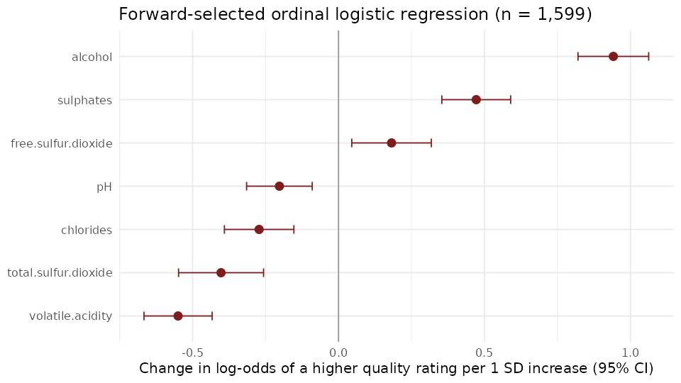
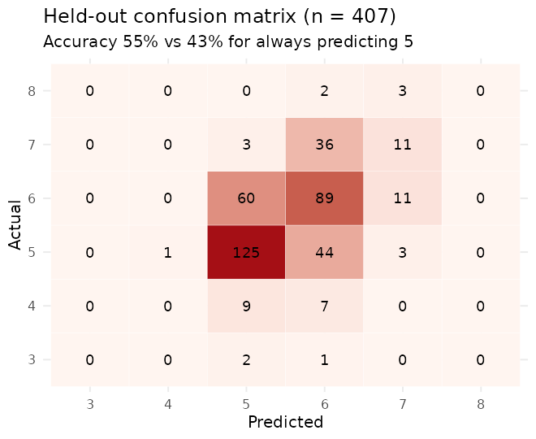

# Wine Quality Explorer (R Shiny)

**Author:** Luke Wamalwa · Applied Statistics & Data Science, University of Kansas Medical Center · Product Development course project (Module 15), Fall 2025

Can a red wine's lab chemistry tell us how a tasting panel will score it? This Shiny app lets you explore the [UCI red Vinho Verde dataset](https://archive.ics.uci.edu/dataset/186/wine+quality) (1,599 wines, quality scored 3-8) and fits an **ordinal logistic regression** that turns a wine's chemistry into a probability for each quality score. Short answer: chemistry explains the *direction* of quality well (more alcohol and sulphates up, volatile acidity down), but it predicts the exact score only modestly better than always guessing "5". The model is useful for ranking wines and for "within one point" estimates, not for pinpointing a score.

## Key results

Numbers below come from `Rscript scripts/evaluate_model.R` (R 4.3.3).

**Model.** Forward stepwise AIC selection keeps 7 of 11 chemical variables (AIC 3,104.8 vs 3,106.9 for all 11 and 3,798.5 for no predictors). All 7 are significant (Wald p < 0.01).



- **Alcohol** has the largest effect: each extra 1% vol multiplies the odds of a higher rating by 2.4.
- **Volatile acidity** (vinegar notes) is the strongest negative effect, followed by total SO2, chlorides and pH.
- **Sulphates** and **free SO2** push ratings up. Total SO2 pushes them down.

**Prediction on unseen wines.** 240 rows are exact duplicates, so I removed them first. That left 1,359 unique wines, which I split 70/30 stratified by quality. Variable selection was rerun on the training set only.

| Held-out test set (407 wines) | Ordinal model | Always predict "5" |
|---|---|---|
| Exact accuracy | **55.3%** | 42.5% |
| Within one point | **95.6%** | n/a |
| Mean absolute error | **0.49** | 0.73 |



The model almost never predicts the rare scores. It predicts 3, 4 and 8 essentially never, and it called most 7s a 6. Accuracy is not a great metric for this skewed target: 82% of wines are a 5 or a 6.

## The app

| Tab | What it does |
|---|---|
| **Exploration** | Filter by quality range. Scatter plot of any two chemical variables. PCA biplot of the 11 chemical variables. Summary cards and Spearman correlations computed from the current selection. |
| **Model** | Coefficients, odds ratios and p-values for the forward-selected model. AIC comparison. Held-out accuracy and confusion matrix. Variance inflation factors. |
| **Prediction** | Set the 7 model variables (ranges match the data, defaults are the median wine) and get the probability of each quality score, the most likely score and the expected score. |

## Run it

```r
install.packages(c("shiny", "shinythemes", "shinycssloaders", "tidyverse",
                   "MASS", "car", "ggfortify"))
shiny::runApp(".")          # from the repository root
```

To reproduce the README numbers and figures, run `Rscript scripts/evaluate_model.R`.

## Repository structure

```
wine_shiny_app/
├── ui.R                       # Shiny UI
├── server.R                   # Shiny server (loads data, fits models at start-up)
├── R/model.R                  # model fitting, VIF, hold-out evaluation (auto-sourced by Shiny)
├── scripts/evaluate_model.R   # prints the numbers above and writes figures/
├── figures/                   # README figures
├── winequality-red.csv        # UCI red wine data (1,599 rows)
└── Wine_Quality_Project_Presentation.pptx   # course presentation (see note below)
```

## Limitations

- **The p-values are optimistic.** Stepwise selection and inference on the same data overstate significance. The selected set is also not stable: on the 70% training split, forward selection picks citric acid and fixed acidity and drops free SO2.
- **Multicollinearity is moderate, not severe.** VIFs computed on the predictors range from 1.4 to 7.8. The highest are fixed acidity at 7.8 and density at 6.3. The values of about 38 for density and 29 for pH that `car::vif()` reports on the `polr` fit are an artefact: that model has no intercept column. The app now computes VIFs from the predictors directly.
- **Proportional odds is assumed and not tested.** The model assumes each variable shifts every quality cut-point equally.
- **Single region, single panel.** The wines are Portuguese Vinho Verde reds scored by expert tasters, so the results may not transfer to other wines.
- **Duplicates.** The 240 duplicate rows are kept for the descriptive model in the app. They are removed only for the held-out evaluation, so that no wine appears in both the training and test sets.

**About the slides.** `Wine_Quality_Project_Presentation.pptx` is the presentation as submitted for the course. It is kept unchanged. Some numbers in it no longer match the code. Its coefficient table differs for sulphates, chlorides, pH and both SO2 terms, and it shows free SO2 as negative. It also quotes the VIF artefact described above. Where they disagree, this README and `scripts/evaluate_model.R` are correct.

## Related project

[wine-quality-analysis](https://github.com/lukahere007/wine-quality-analysis) analyses the same UCI data (red and white wines) in Python, using factor analysis and k-means clustering.

## Data and references

Cortez, P., Cerdeira, A., Almeida, F., Matos, T., & Reis, J. (2009). Modeling wine preferences by data mining from physicochemical properties. *Decision Support Systems*, 47(4), 547-553. Data: UCI Machine Learning Repository (CC BY 4.0).

Tufte, E. R. (1983). *The Visual Display of Quantitative Information*. Graphics Press.

## License

MIT. See [LICENSE](LICENSE).
